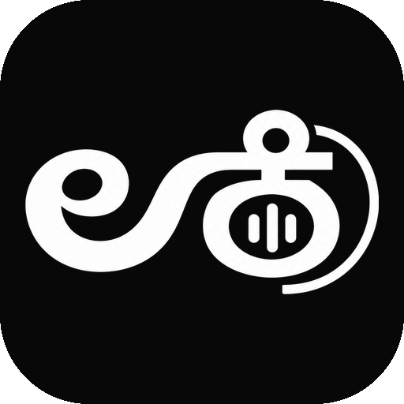

<p align="center">
  
</p>

<h1 align="center">Ukti</h1>

<p align="center">
  <em>ಉಕ್ತಿ — "utterance" in Kannada</em>
</p>

<p align="center">
  Hold <kbd>Ctrl</kbd>+<kbd>Space</kbd>, speak, release.<br>
  Your words appear at the cursor — entirely on your own PC.
</p>

<p align="center">
  
  
  
  
</p>

---

<p align="center">
  
</p>

<p align="center">
  <sub>A warm braided dot field follows your voice. A compact spinner appears while transcribing.</sub>
</p>

## Why another dictation tool

Most voice-typing tools either send your audio to a server or bury the one
feature you wanted under a subscription and a settings maze.

Ukti does one thing: **press two keys, talk, get text.** Audio never leaves the
machine, there is no account, and there is no history. When you release the keys
the transcript is pasted and the audio is gone.

## How it feels to use

1. Click into any text field — editor, browser, chat, terminal.
2. **Hold** <kbd>Ctrl</kbd>+<kbd>Space</kbd>. A capsule appears at the top of the screen.
3. Speak normally.
4. **Release**. The text is inserted where your cursor was.

Press <kbd>Esc</kbd> mid-sentence to cancel without inserting anything.
The shortcut defaults to Ctrl+Space and can be changed in Settings. Release all
shortcut modifiers before insertion; if you keep them held, Ukti offers the text
on the clipboard rather than sending an unintended key combination.

## Preferences

<p align="center">
  
</p>

A single page, with no redundant sidebar. The dark surfaces and compact controls
are inspired by [Hex](https://github.com/anomalyco/hex).

- **Enable dictation:** applies immediately, including from the tray. Turning it
  off releases the microphone and shortcut and discards any in-flight result.
- **Shortcut:** click the control, then press Ctrl or Alt with a letter, number,
  Space, or F1–F11. Shift can be added. Reserved combinations are rejected.
  Escape cancels recording the shortcut; Tab moves to the next control. Choose
  a combination not already used by your other apps.
- **Manage models:** download once, then select a cached model without downloading
  again. Save changes applies the selection. A failed load keeps the previous selection,
  which can be reloaded on the next shortcut hold without keeping two workers resident.
  Select an unused downloaded model and click **Delete model** to reclaim its disk
  space, after confirmation. Switch to another model and save before deleting the
  current model. Deleted models can be downloaded again.
- **Unload model when idle:** defaults to **5 minutes**; choose 1, 2, 5, 10, 15,
  30, or 60 minutes, or **Never**. Save applies the timeout. After inactivity,
  Ukti exits its speech worker to release model RAM/VRAM and native/CUDA caches,
  and closes the microphone. It keeps the downloaded file. Hold the shortcut to
  wake it; wait for **Listening** before speaking. A tap released while it still
  says Waking only wakes the model, without recording an utterance.
  Active recording, processing, loading and pending paste operations are protected.
  Inactive models still unload with Settings open or after an input error.
- **Microphone, Windows startup and background behavior:** remain on the same page.
  Turning background behavior off makes the close button / Alt+F4 quit Ukti.

Save applies preferences other than on/off. Cancel, Escape, and the close button
discard unsaved preferences, but do not undo an immediate on/off change or delete
a completed model download. Double-click the tray icon to reopen Settings.

### Local speech models

| Model | Download | Coverage | License |
| --- | --- | --- | --- |
| Nemotron English (default) | 700 MB | English, punctuation | NVIDIA Open Model License |
| Nemotron 3.5 | 742 MB | Multilingual, automatic language detection | NVIDIA Open Model License (OpenMDW 1.1) |
| Parakeet TDT v3 | 714 MB | 25 European languages | CC-BY-4.0 |
| Parakeet CTC | 1.18 GB | English, unpunctuated output | CC-BY-4.0 |

All use the bundled NeMo-Speech.cpp CUDA runtime and Q8_0 weights. Coverage and
VRAM requirements depend on the model; the chooser links each official model
card and license. Downloads are pinned to a revision and verified by size and
SHA-256 before being activated. You can cancel or retry without changing the
active model. No Whisper/cloud backends from Hex are implied.

## Performance

Measured with the default Nemotron English model on an RTX 3050 Laptop GPU
(6 GB), 16 kHz mono capture. Other models have not been benchmarked here:

| Audio length | Transcription | Realtime factor |
| ----------- | ------------- | --------------- |
| 1 s         | 22 ms         | 0.022×          |
| 3 s         | 35 ms         | 0.012×          |
| 9.2 s       | 81 ms         | 0.009×          |

- **Model load:** starts a fresh isolated worker and warms the GPU at startup and after idle unloading; latency depends on the model and device.
- **Microphone:** kept open while dictation is enabled and the model is awake. Turning dictation off or unloading the idle model closes it.
- **Idle memory:** after the configured timeout, Ukti closes its isolated speech worker, releasing model weights and the worker's native/CUDA allocations. Only the tray app remains; its exact RAM usage depends on Windows and UI activity. A small working-set reading alone does not describe total committed memory.

## Accuracy

The following measurements use Nemotron English (0.6B, Q8_0), decoded locally.
They do not describe every available model.

On a varied 8-sentence benchmark across two voices — clean and at 8 dB SNR —
word error rate was **0.0%**, with punctuation exact and only two casing quirks.

The single biggest accuracy factor is **which microphone you use**. A Bluetooth
headset typically runs its hands-free profile, which captures narrowband audio;
no decoder setting can recover speech detail that was never recorded. The
settings window warns when a headset is selected, and the built-in microphone
almost always transcribes better.

## Privacy

- Inference, punctuation, and text insertion all happen on-device.
- The app only accesses the network when you choose to download a model.
- No audio or transcript is written to disk. Ever.
- No telemetry, no accounts, no cloud fallback.

## Install

### Requirements

- Windows 10 or 11, x64, with .NET Framework 4.8 or newer
- An NVIDIA GPU with CUDA support (the speech runtime is GPU-only by design)
- ~2 GB of disk for the runtime, plus 700 MB–1.18 GB per downloaded model

### Windows EXE installer

The installer build produces **`dist\Ukti-Setup-1.0.0-win-x64.exe`** locally;
compiled installers and runtimes are not stored in this source repository.
This is a small web installer (under 1 MB): it embeds the app, downloads the pinned NVIDIA runtime during
setup, and verifies the archive and extracted DLL checksums. A matching existing
Ukti runtime is reused. It does **not** bundle a speech model or personal settings.

Installation is per-user in `%LOCALAPPDATA%\Programs\Ukti`, with Start-menu
shortcuts and a Windows Apps uninstaller. On first launch, choose/download a
model to `%LOCALAPPDATA%\Ukti\models`. Setup needs Internet for the runtime
(about 485 MiB) and roughly 2 GB temporary free space; the initial model download
is separate. Later dictation is offline. Uninstall preserves cached models and
preferences. The current installer is unsigned, so SmartScreen may warn.

Build or test the installer:

```powershell
.\scripts\package-exe.ps1                         # small web setup
.\scripts\package-exe.ps1 -Offline                # runtime bundled, still no model
.\scripts\test-runtime-bootstrap.ps1             # verification fixtures; no network
.\scripts\test-installer.ps1 -RuntimeDirectory app -RuntimeTest
```

If the runtime is already in another Ukti folder, use
`Ukti-Setup-1.0.0-win-x64.exe /RUNTIME_DIR="D:\path\to\Ukti\app"` to reuse its
verified DLLs instead of downloading. An NVIDIA driver alone is not the NeMo
speech runtime. See `packaging\INSTALL.txt` for requirements and details.

### From source

```powershell
git clone https://github.com/redmoon0x/ukti.git
cd ukti

# Compile — requires the .NET SDK on the development machine
.\build.cmd

# Fetch the speech runtime (~700 MB, from NVIDIA's official release)
.\scripts\fetch-runtime.ps1

# Start it
.\app\Ukti.exe
```

On first launch, choose and download a model into `%LOCALAPPDATA%\Ukti\models`, then select
your microphone in Settings. Later launches reuse the saved model and shortcut.
Existing `nemotron-en.q8_0.gguf` downloads and old settings are reused.

## What it does and does not do

**Does**

- Hold-to-talk dictation with a configurable global shortcut
- Immediate enable/disable, including microphone release
- Choice of four local models, including multilingual options
- Configurable idle unloading (5-minute default), automatic wake, and confirmed deletion of unused downloads
- Pastes into whatever app has focus, with a clipboard fallback if focus moved
- Microphone selection, start-with-Windows, and run-in-background options
- Cancels cleanly with <kbd>Esc</kbd>

**Does not**

- Translate, summarise, or rewrite what you said
- Store history, recordings, or transcripts
- Require an account, a subscription, or a connection
- Guarantee support for languages outside the selected model's coverage

## How it is built

A Windows C# tray app with a disposable local ASR worker. No Python, Electron,
network service, or audio uploads. The worker exits on idle unload and is tied
to the tray process by a kill-on-close Windows job, including if the tray crashes.

```
Ukti.exe (tray)
├── Global hold-to-talk via Raw Input
├── WASAPI capture → 16 kHz mono + audio conditioning
├── Private local pipe → Ukti.exe --asr-worker
│                       └── NeMo-Speech.cpp + CUDA (released on worker exit)
├── Clipboard paste with focus validation
└── Tray icon + listening capsule
```

Three decisions did most of the work:

**CUDA over Vulkan.** The Vulkan build ran the wrong decode path for this model
and was ~12× slower. Switching backends took a 9-second clip from 1047 ms to
81 ms.

**Hold-to-talk needs press and release events.** `RegisterHotKey` only reports
presses. Raw Input observes both transitions behind other windows without relying
on a low-level hook that Windows can silently remove for timing out.

**The microphone stays open.** Opening a capture device costs roughly half a
second — unacceptable *after* the user has started talking. The device streams
continuously while dictation is enabled and the model is awake, with capture
gated in software. Pausing or idle unloading closes the device. After sleeping,
wait for the listening indicator before speaking; the worker must reload and warm first.

### Layout

```
src/
  Program.cs        tray, state machine, lifecycle
  HoldHotkey.cs     configurable Raw Input hold/release detection
  Shortcut.cs       chord validation and persistence
  ShortcutRecorder.cs keyboard-driven shortcut editor
  ModelCatalog.cs   pinned model metadata, cache deletion and verification
  IdleUnloadPolicy.cs timeout policy and idle-setting control
  AudioCapture.cs   WASAPI capture, device selection, level metering
  AsrProcess.cs     isolated ASR worker, private pipe, kill-on-close job
  WorkCoordinator.cs bounded workers, cancellation, result ownership
  AudioPipeline.cs  conditioning before recognition
  NemoAsr.cs        P/Invoke bindings for the C ABI
  TextInjector.cs   clipboard paste, focus guard, restoration
  PillForm.cs       the listening capsule
  DotScope.cs       braided dot-field simulation
  Theme.cs          palette, brand mark, shared drawing
  UiControls.cs     native window chrome, accessible controls, dark menus
  SettingsForm.cs   preferences window
  ModelSetupForm.cs local model library, verified downloads and cancellation
  Memory.cs         optional managed-buffer collection after unload
  Ipc.cs            single-instance signalling
  Startup.cs        per-user Run-key registration
```

## Credits

The listening indicator is a port of the **dot scope** from
[Hex](https://github.com/anomalyco/hex) — a braided pair of oscilloscope traces
with phosphor persistence and an auto-levelling meter. The visual language
draws from their current Rune desktop settings: neutral dark surfaces, grouped
rows, and compact controls, adapted to Ukti's single-page settings. The supplied
Kannada voice-recording artwork is used for the executable, windows, tray,
capsule and documentation. See [the UI notes](docs/ui-refresh.md) for verification.

Speech recognition runs on
[NeMo-Speech.cpp](https://github.com/NVIDIA/NeMo-Speech.cpp) by NVIDIA. Model
artifacts, revisions and hashes come from its
[v0.3.0 model index](https://github.com/NVIDIA/NeMo-Speech.cpp/blob/v0.3.0/models/index.json).

Weights are **not** included in this repository; download only the models you
want from their official NVIDIA repositories on Hugging Face.

## License

Code is released under the MIT License — see [LICENSE](LICENSE).

The speech runtime and model weights carry their own licenses, listed above.
Review the official model cards before redistributing a packaged build.
