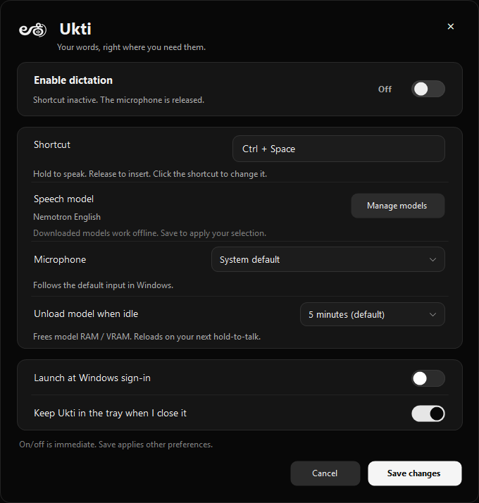
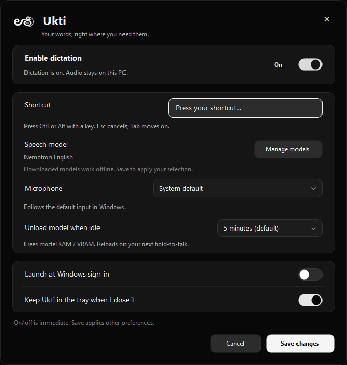
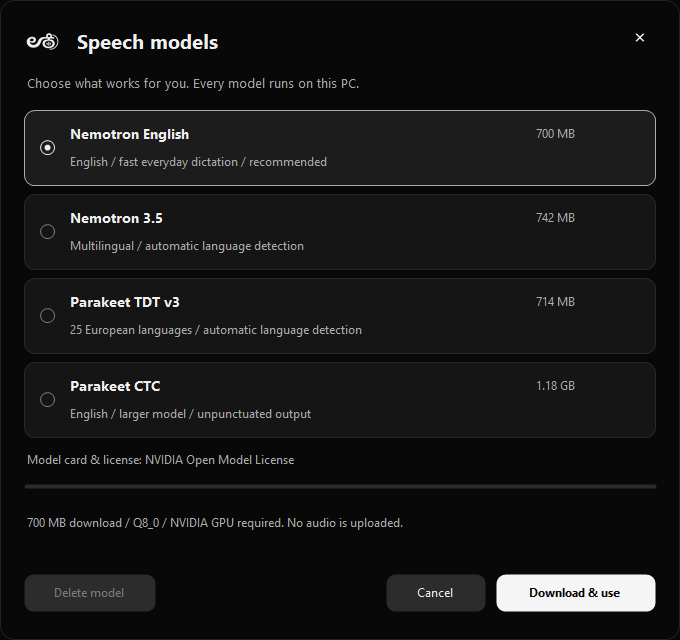
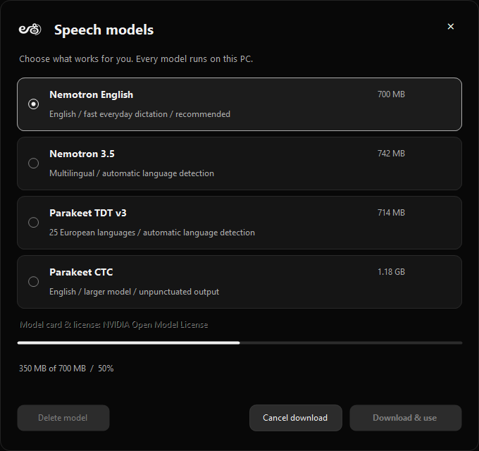
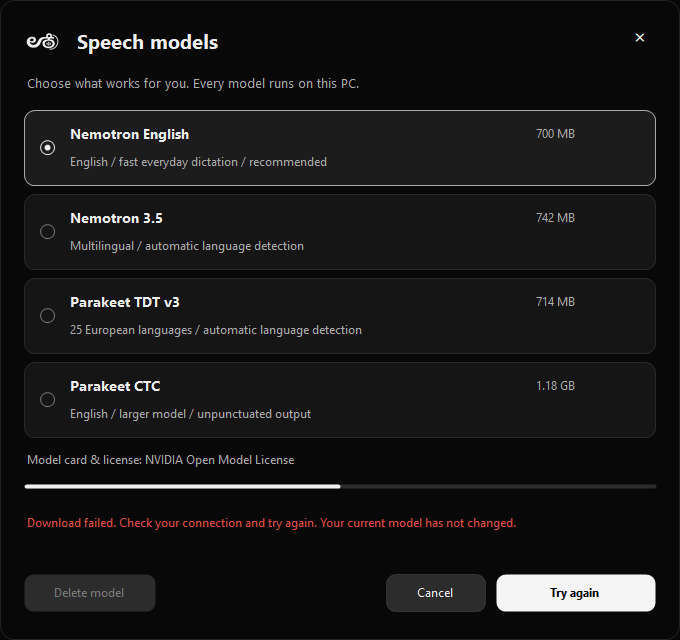

# Ukti UI and interaction refresh

Design reference: [anomalyco/hex](https://github.com/anomalyco/hex/tree/648ec4725a6cca53dad9b84ec718675cf293cf1a),
particularly its current dark settings and processing capsule. This remains a
native WinForms app, not a port of Hex or its cloud/Whisper backends.

## Single-page preferences

- No sidebar or fake navigation for a single page.
- Immediate, explicitly labelled On/Off control. Off closes the microphone,
  releases the shortcut and invalidates an in-flight transcription. Re-enabling
  cannot revive that discarded result. The tray offers the same control.
- Click or keyboard-activate the shortcut to record Ctrl/Alt plus a letter,
  number, Space, or F1–F11, optionally with Shift. Plain keys, Shift-only chords,
  Escape, Windows keys and reserved Alt+F4 / Alt+Space combinations are rejected.
  Escape cancels recording without closing settings; Tab moves on.
- Save applies the staged shortcut, microphone, startup behavior and model.
  Cancel/Escape/close discard these staged choices. On/off changes are immediate
  and are not rolled back. Downloads remain cached even if preferences are cancelled.
- Idle unloading defaults to five minutes, with 1/2/5/10/15/30/60 minute and Never
  choices. The timeout is staged until Save, migrates into old settings, and uses
  a monotonic clock. Active loading, recording, transcription, pending insertion,
  and other model operations are protected. Open settings and input-error states
  do not prevent an inactive model from unloading.
- Double-clicking the tray icon reopens settings. Window close / Alt+F4 honors
  the saved background preference; Save and Cancel are not process-quit actions.
- Hover/pressed/disabled/focus states, keyboard activation, accessible names,
  roles, checked states, and arrow-key selection in the model chooser.

The shortcut is suspended while settings is open, so recording a new chord cannot
start dictation. On normal use it consumes only its trigger, pairs key down/up,
ignores auto-repeat and injected paste events, and finishes on trigger release or
release of a required modifier. Alt chords mask bare-Alt menu activation. Insertion
waits briefly for modifiers to be released; if they remain held, the transcript is
copied rather than sending Ctrl+V with Alt/Shift still down. A focus change also
uses the clipboard fallback, never pasting into a different window.

## Four supported local models

The chooser uses ASR artifacts from the **bundled runtime's**
[NeMo-Speech.cpp v0.3.0 index](https://github.com/NVIDIA/NeMo-Speech.cpp/blob/v0.3.0/models/index.json):

| ID | Model | Size | Language mode |
| --- | --- | --- | --- |
| `nemotron-en` | Nemotron English | 699,872,960 bytes | English |
| `nemotron-3.5` | Nemotron 3.5 | 741,548,352 bytes | Automatic |
| `parakeet-tdt` | Parakeet TDT v3 | 713,975,456 bytes | Automatic / 25 European languages |
| `parakeet-ctc` | Parakeet CTC | 1,178,100,960 bytes | English / unpunctuated output |

All are Q8_0. Each entry shows download size or downloaded status, description,
and a link to the official model card and license. The app does not promise
support for a language outside the selected model's documented coverage.

Downloads use pinned HTTPS URLs and a unique `.partial` file. Size and SHA-256
are verified off the UI thread before an atomic promotion. Cancellation, retry,
insufficient disk space, checksum errors and file-write errors leave existing
models intact. Switching model loads and warms the replacement before committing
the preference; failure keeps the previous recognizer and model selection.
Only one model/download operation is offered at a time. No multi-GB models were
automatically downloaded during development.

Old settings acquire the default shortcut and model automatically. Existing
`app/models/nemotron-en.q8_0.gguf` files are reused. `VT_MODEL`, if set to an
existing file, remains a startup path override; selecting a model in settings
uses the catalog for that running session. A persistent `VT_MODEL` takes effect
again on the next launch.

## Idle memory and download management

Idle unloading detaches and exits an isolated ASR process, releasing its model
allocations and native/CUDA caches. No ASR DLL loads in the tray process. The
microphone closes too. Cached GGUF weights and the model selection stay on disk.
Settings may stay open, and a microphone error does not pin model memory forever.
Active recording, transcription, loading and a pending paste still block unloading.
The idle timer starts before showing startup preferences, not after their modal
loop returns. Managed-buffer collection is optional; EmptyWorkingSet is not used
to make retained committed memory look smaller.

A distinct sleeping state keeps the wake shortcut available without holding an
ASR instance. On the next hold, the microphone opens off the UI thread and the
capsule first says Waking. Wait for Listening before speaking. Capture buffers
only after the worker has loaded and warmed. Esc while holding or turning
dictation off discards the utterance. A short tap released while the capsule
still says Waking only wakes the model, without recording or
inserting anything. Shutdown disposes both queued and adopted native resources.

Manage models offers **Delete model** for an unused cached model, with a No-default
confirmation explaining permanent deletion and re-download. The current saved
model is protected, even when sleeping: switch to another model and Save first.
Deletion is immediate and is not undone by cancelling preferences. Both canonical
and legacy English filenames are removed if present. No wildcard deletes,
partial downloads, unrelated files, or external `VT_MODEL` paths are targeted.
Delete is blocked during downloading and verification; errors retain an operable
chooser, and a deleted model immediately offers Download & use again.

## Branding and capsule

Source artwork: `src/assets/brand-source.png`, copied from the supplied
`Minimal Kannada Voice Recording Icon.png`. Its white mark is extracted with
antialiased transparency, without redrawing its geometry. The mark is embedded
in the executable and used in windows, tray state icons, both capsule states,
and documentation. `src/assets/ukti.ico` contains 16–256px icon sizes.

`python scripts/generate-icons.py` regenerates the assets with Pillow. This is an
optional asset-authoring tool, **not** an application runtime dependency.

The listening dot scope remains audio-driven. The processing capsule has an
eight-dot spinner and text-measured width. Native no-activation/click-through
styles and a no-activate z-order call keep it from taking keyboard focus.
Per-pixel transparency preserves rounded edges. Brand tints are cached at their
actual display size instead of allocating full-size artwork every frame.

## Verify on Windows

```powershell
.\build.cmd
.\scripts\test-ui.ps1
# Regenerate only composition/form snapshots, never capture the desktop:
.\scripts\test-ui.ps1 -Screenshots
# Requires the CUDA runtime and an already-downloaded model; no network/mic:
.\scripts\test-runtime.ps1
.\scripts\test-runtime.ps1 -Model parakeet-tdt
```

The UI runner compiles the real sources into an isolated temporary directory.
It opens test forms, but never starts ASR, installs global hooks, accesses the
network, or modifies user preferences. It covers settings migration and round-trip,
all boolean combinations, immediate On/Off notifications, missing-engine and
in-flight pause guards, shortcut recording and key-state sequences, keyboard and
accessible actions, chooser navigation, progress/retry/cancel, checksum and
atomic promotion behavior, timeout migration and Never/default/custom values,
idle/busy/settings guards, actual disposal orchestration, wake-buffer retention
and cancellation, queued resource cleanup on shutdown, current-model protection,
delete confirmation/cancellation, canonical/legacy removal, preserved unrelated
files, branding, capsule sizing, transparency and non-activation.

The runtime smoke test now explicitly requests each due unload (deferred-start
test contexts have no timer). It exercises idle, input-error and Settings-open
states, checks that each worker PID really exits, verifies reload and cached-file
preservation, and rejects native ASR/CUDA modules in the tray process. It also
bounds post-unload tray private-memory growth, rather than treating a trimmed
working set as evidence that allocations were released.

On the installed Nemotron English model/RTX 3050 setup, three cycles left the
tray at approximately 29 MiB private memory instead of retaining about 1 GiB of
native overhead. The loaded worker separately used about 7 GiB private committed
memory; committed memory is not the same as physical RAM. Worker exit releases
its allocations, rather than carrying them through sleeping state. Other models
must be tested after downloading them through the chooser; no claim is made
about their local accuracy or memory requirements.

The app retains Windows DPI virtualization; no new DPI-awareness manifest or UI
framework/dependency was introduced.

### Dropdown and paste interaction regressions

```powershell
# Uses a scratch editor and isolated preferences; briefly takes foreground focus:
.\scripts\test-interaction.ps1
# Also tests synthesized speech through the installed English NeMo model/CUDA runtime:
.\scripts\test-interaction.ps1 -Speech
```

These checks exercise ToolStrip mouse-up/close/click ordering (not only
`PerformClick`), save the microphone, reload preferences from disk, and verify
that recognized text actually appears in an editor through native Ctrl+V.
The native `INPUT` union must be 40 bytes on x64; a keyboard-only union made
Windows reject every paste event. Menus remain owned by their controls instead
of being disposed inside `Closed`, which previously threw before the selected
microphone's click handler could run. Settings writes are atomic and failed
writes are reported. No microphone is opened by these interaction tests.

## Screens














